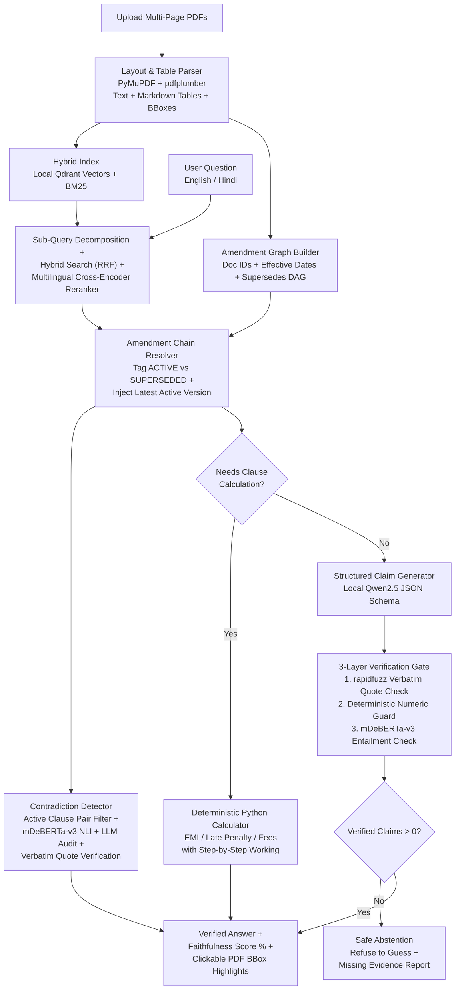

# Zero-Guessing & Contradiction-Checking Document AI

A **100% open-source, locally hosted verifiable Document AI assistant** that answers complex questions across multiple PDFs using only exact, verifiable proof. It tracks multi-hop amendment chains (`A → B → C`), flags contradicting clauses side by side, performs deterministic financial calculations, highlights cited passages directly on rendered PDF pages, and refuses to guess whenever evidence is missing.

> **Zero Paid APIs • 100% Local Privacy:** Every model (LLM, embeddings, reranker, and NLI verifier) runs locally—no confidential documents ever leave your machine.

---

## Key Features

### Core Verification Capabilities
- **Multi-Document Evidence Retrieval:** Parses multi-page PDFs and structured tables (`PyMuPDF` + `pdfplumber`) and combines dense semantic search (`Qdrant`) with lexical keyword search (`BM25`) using Reciprocal Rank Fusion (RRF) and multilingual cross-encoder reranking.
- **Exact Citations & Verbatim Proof:** Every claim in an answer links to the exact document name, page number, and verbatim quote—verified programmatically via `rapidfuzz` before display.
- **Amendment Chain Resolution (`A → B → C`):** Extracts document IDs, effective dates, and superseding references to build a chronological amendment graph, tagging clauses as `ACTIVE` vs `SUPERSEDED` and resolving which rule applies today.
- **Side-by-Side Contradiction Detection:** Compares active clauses across independent documents using `mDeBERTa-v3` NLI + structured LLM auditing + verbatim quote verification, surfacing conflicting numbers, limits, or rules side by side.
- **Zero-Guessing Abstention Gate:** Every claim must pass a 3-layer verification gate (Verbatim Quote Match + Deterministic Numeric Guard + NLI Entailment). Unsupported claims are blocked, and when proof is insufficient, the system safely abstains (`"I don't have enough proof"`) and states what evidence is missing.
- **Faithfulness Score:** Displays the exact percentage and ratio of answer sentences backed by verified matching source quotes.

### Bonus Features Implemented
- **Clickable PDF Passage Highlighting:** Clicking any citation or contradiction quote jumps the right-side rendered PDF viewer to the exact page and overlays translucent bounding-box highlights (`yellow` for verified evidence, `red` for conflicts).
- **Multilingual / Hindi Q&A Support:** Supports questions in English, Hindi, or Hinglish against English PDFs, returning natural Hindi answers grounded in original English verbatim quotes.
- **Deterministic Clause Calculator:** Extracts verified active rates from clauses/tables and computes **Late Payment Penalties**, **Reducing-Balance EMIs**, and **Percentage Fees** in Python with step-by-step working—eliminating LLM arithmetic errors.

---

## Verification Pipeline Architecture



---

## Open-Source Models & Tech Stack

| Layer / Role | Open-Source Model / Tool | Purpose |
| :--- | :--- | :--- |
| **Local LLM** | `qwen2.5:3b` (via Ollama) | Structured JSON claim generation, amendment metadata extraction, multilingual Q&A (English + Hindi), calculation parameter extraction. |
| **Embeddings** | `intfloat/multilingual-e5-small` | Cross-lingual dense retrieval across English PDFs and English/Hindi queries. |
| **Lexical Search** | `BM25Okapi` (`rank-bm25`) | Exact matching of clause IDs, document IDs, dates, rates, and percentages (merged with vectors via RRF). |
| **Reranker** | `cross-encoder/mmarco-mMiniLMv2-L12-H384-v1` | Multilingual cross-encoder reranking of top hybrid candidates. |
| **NLI Verifier** | `MoritzLaurer/mDeBERTa-v3-base-mnli-xnli` | Claim-to-quote entailment checking and pairwise contradiction scoring. |
| **PDF & Table Parsing** | `PyMuPDF` (`pymupdf`) + `pdfplumber` | Accurate Markdown table extraction, raw page text, bounding boxes (`bbox`), and high-DPI page rendering. |
| **Vector Store** | `Qdrant` (Local Embedded Mode) | Persistent local vector indexing without requiring Docker or cloud services. |
| **Backend API** | `FastAPI` + `Uvicorn` | REST APIs for multi-PDF ingestion, verified Q&A, document management, and page rendering. |
| **Frontend Web App** | `Next.js` (TypeScript + Tailwind CSS + `lucide-react`) | Split-screen UI with live Q&A, faithfulness badges, side-by-side contradiction cards, amendment timelines, calculation breakdowns, and highlighted PDF viewer. |

---

## Project Structure

```text
Doc_AI/
├── backend/
│   ├── app/
│   │   ├── main.py                              # FastAPI server & REST endpoints
│   │   ├── config.py                            # Paths & open-source model configuration
│   │   ├── pipeline.py                          # End-to-end verification-first orchestrator
│   │   ├── ingestion/
│   │   │   └── pdf_parser.py                    # PyMuPDF + pdfplumber parser (tables + bboxes)
│   │   ├── retrieval/
│   │   │   ├── hybrid_search.py                 # Local Qdrant + BM25 + RRF + Cross-Encoder
│   │   │   └── amendment_graph.py               # DAG builder & ACTIVE/SUPERSEDED resolver
│   │   ├── verification/
│   │   │   ├── quote_matcher.py                 # rapidfuzz quote verifier & numeric guard helpers
│   │   │   ├── nli_checker.py                   # mDeBERTa-v3 entailment & contradiction scorer
│   │   │   ├── verifier.py                      # 3-layer verification gate, abstention & faithfulness
│   │   │   ├── contradiction_detector.py        # Active conflict audit with verified quotes
│   │   │   └── calculator.py                    # Deterministic Python EMI / penalty / fee engine
│   │   └── llm/
│   │       └── ollama_client.py                 # Local Ollama JSON-schema client
│   ├── scripts/
│   │   ├── create_sample_pdfs.py                # Generates 4 banking/policy test PDFs
│   │   ├── verify_phase1.py                     # Sanity check (PDFs + Ollama)
│   │   ├── verify_phase2.py                     # Hybrid retrieval & table parsing test
│   │   ├── verify_phase3.py                     # Verification gate, abstention & Hindi test
│   │   └── verify_phase4.py                     # Amendment chain, contradiction & calculator test
│   └── storage/                                 # Local Qdrant DB, parsed chunks, amendment graph, uploads
├── frontend/
│   └── src/
│       ├── app/page.tsx                         # Split-screen Q&A, alerts, timelines & upload UI
│       ├── components/PdfHighlightViewer.tsx    # Rendered PDF viewer with BBox highlight overlays
│       └── types/docai.ts                       # TypeScript API response interfaces
├── sample_docs/                                 # Default demo PDFs (Doc A, B, C, D)
└── README.md
```

---

## Backend API Endpoints

| Method | Endpoint | Description |
| :--- | :--- | :--- |
| `GET` | `/api/health` | Health check with indexed chunk count and active document list. |
| `GET` | `/api/documents` | Lists all uploaded PDFs, page counts, document IDs, effective dates, and amendment chains. |
| `POST` | `/api/upload` | Uploads one or more PDFs and automatically re-parses, re-indexes, and rebuilds the amendment graph. |
| `DELETE` | `/api/documents/{doc_name}` | Removes a PDF and refreshes the index. |
| `POST` | `/api/reset-samples` | Restores and re-indexes the 4 built-in banking demo PDFs. |
| `POST` | `/api/query` | Runs the full retrieval, amendment resolution, contradiction audit, calculation, and verification pipeline. |
| `GET` | `/api/pdf-page/{doc_name}/{page_number}` | Renders a specific PDF page as a high-DPI PNG for pixel-accurate highlight overlays. |
| `GET` | `/api/pdf-raw/{doc_name}` | Streams the original PDF file. |

---

## How to Run Locally

### Prerequisites
- **Python 3.10+**
- **Node.js 18+** & **npm**
- **Ollama** installed locally (`https://ollama.com`)

### 1. Start Local Ollama & Pull Model
```bash
ollama serve
ollama pull qwen2.5:3b
```
*(Optional: On machines with 16GB+ RAM, you can pull `qwen2.5:7b` and update `OLLAMA_MODEL` in `backend/app/config.py`.)*

### 2. Setup & Start FastAPI Backend
```bash
# From project root
python3 -m venv venv
source venv/bin/activate

cd backend
pip install --upgrade pip
pip install reportlab pymupdf pdfplumber requests qdrant-client sentence-transformers rank-bm25 rapidfuzz sentencepiece fastapi uvicorn python-multipart

# Generate the 4 sample banking PDFs (if not already present)
python scripts/create_sample_pdfs.py

# Start backend server on http://localhost:8000
uvicorn app.main:app --reload --port 8000
```
Verify backend health at `http://localhost:8000/api/health`.

### 3. Setup & Start Next.js Frontend
Open a new terminal tab:
```bash
cd frontend
npm install
npm run dev
```
Open **http://localhost:3000** in your browser.

---

## Built-In Demo Scenarios (Included Sample Pack)

The app pre-loads 4 realistic banking policy PDFs (`DocA_Loan_Policy_2023.pdf`, `DocB_Circular_2024.pdf`, `DocC_Circular_2025.pdf`, and `DocD_Partner_Addendum_2025.pdf`) and provides **1-click demo chips** in the UI:

| Demo Scenario | Sample Query | Expected Behavior |
| :--- | :--- | :--- |
| **Amendment Chain (`A → B → C`)** | *"What is the currently applicable interest rate for a Retail Personal Loan?"* | Resolves `9.50% (2023) → 10.50% (2024) → 11.25% (2025)`, answers **11.25% p.a.**, and renders the full timeline. |
| **Contradiction Detection** | *"What is the maximum repayment tenure and minimum applicant age?"* | Flags side-by-side conflicts between `DocA` (`60 months / 21 yrs`) and `DocD` (`48 months / 25 yrs`) with clickable red PDF highlights. |
| **Penalty Calculation** | *"If my overdue EMI is INR 20,000 for 2 months past the grace period, what is the total late payment penalty?"* | Uses active `3.0%/month` rate (`DocB`, retained in `DocC`) and computes **INR 1,200.00** with step-by-step working. |
| **EMI Calculation** | *"Calculate the monthly EMI for a Retail Personal Loan of INR 5,00,000 for 24 months at the current interest rate."* | Uses active `11.25% p.a.` rate (`DocC`) and computes **INR 23,362.00 / month** with full formula breakdown. |
| **Zero-Guessing Abstention** | *"What is the loan policy for NRI applicants or cryptocurrency collateral?"* | Refuses to guess, triggers **Safe Abstention**, and reports missing evidence clearly. |
| **Hindi Cross-Lingual Q&A** | *"Personal loan ke liye minimum monthly income kitni honi chahiye?"* | Answers in Hindi (`INR 30,000`) backed by a verified English verbatim quote from `DocA` Page 1. |